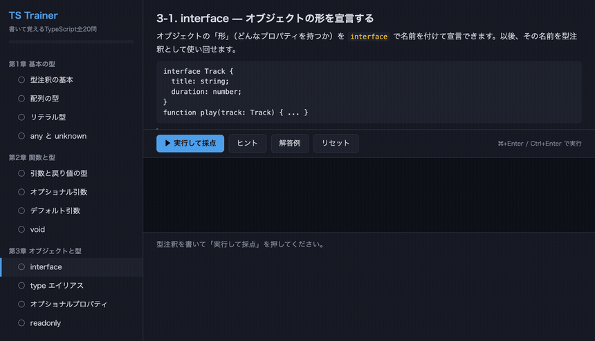

# TS Trainer — 書いて覚えるTypeScript

読むだけでは書けるようにならないので、**書いて、即採点して、次へ**進むだけのドリル。
[JS Trainer](https://github.com/npulsar-droid/js-trainer) の型あり版です。



**▶ その場で試す: https://npulsar-droid.github.io/ts-trainer/**

**単一HTMLファイル・依存ゼロ・ビルド不要。** TypeScriptのインストールも `tsc` も要りません。

## 全5章20レッスン

| 章 | 内容 |
|---|---|
| 第1章 基本の型 | 型注釈の基本 / 配列の型 / リテラル型 / any と unknown |
| 第2章 関数と型 | 引数と戻り値の型 / オプショナル引数 / デフォルト引数 / void |
| 第3章 オブジェクトと型 | interface / type エイリアス / オプショナルプロパティ / readonly |
| 第4章 合併・交差・ジェネリクス | ユニオン型 / 交差型 / ジェネリクス / 型ガード |
| 第5章 実践 | Partial / Pick・Omit / Record / 卒業課題 |

各レッスンには、その章に対応する公式ハンドブックのページへのリンクが付いています。

## 採点の仕組みと、その限界

**このドリルは型チェッカーではありません。** 採点は2段構えで、
書いたソースに対する検査（`interface Track を定義` `title: string を持つ` など）と、
型注釈を除去して JavaScript として実行した結果の検査を組み合わせています。

つまり「型を書いたか」は見ていますが、**型システムとして正しいかはコンパイラに通していません。**
型の書き方そのものを確かめたいときは、各レッスンから
[TypeScript Playground](https://www.typescriptlang.org/play) に貼って試してください
（アプリ内にもリンクがあります）。

型の除去は正規表現ベースの簡易実装（`stripTypes()`）で、収録している課題の範囲で動くものです。
任意のTypeScriptをコンパイルできるわけではありません。

## 使い方

- 採点はブラウザの中だけで完結します。サーバも通信もありません
- 詰まったら「ヒント」、それでもだめなら「解答例」
- 書いたコードは自動保存されます（localStorage）

## 動かす

```bash
open index.html   # macOS。Windows / Linux ではブラウザで index.html を開く
```

ローカルサーバ経由でも動きます。

```bash
python3 -m http.server 8345
```

> **注意**: `file://` と `localhost` では localStorage の保存先が別になります。
> 進捗を続けたいなら開き方を統一してください。

## テスト

```bash
node test.mjs
```

`index.html` 内のエンジン部分（型除去・採点ロジック・種データ）を抽出して77件を検証します。
ブラウザも npm も要りません。

## ライセンス

MIT
